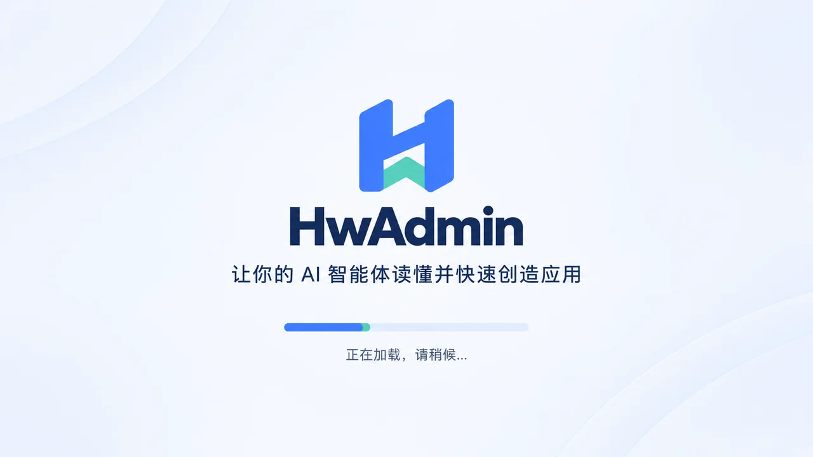

<div align="center">
  <picture>
    <source media="(prefers-color-scheme: dark)" srcset="server/public/brand/logo-horizontal-dark.webp" />
    
  </picture>

  <h3>让你的 AI 智能体读懂，并快速创造应用</h3>

  <p>
    
    
    
    
  </p>
</div>

<p align="center">
  
</p>

# HwAdmin

**让你的 AI 智能体读懂，并快速创造应用。** 当前源码版本 **1.6.1**。

把统一完整发行包解压到工作区或服务器，告诉智能体想做什么即可开发与上线。网站、管理后台、小程序的环境准备、业务开发和上线配置，由 Agent 处理。

## 你只需要这样开始

下载统一完整包 `hwadmin-v1.6.1.zip`，解压后把下面这句话发给你的 Agent：

> 先阅读 START_HERE.md，帮我做一个【你的业务目标】。先做出可以预览的版本，页面和功能确认后，再帮我部署上线。

例如：装修公司官网、客户管理系统、门店预约小程序。先看到应用，再边看边改。

## Agent 的快捷入口

优先阅读 **[START_HERE.md](START_HERE.md)**，按业务目标执行一条命令：

```bash
./hw start website --name "我的公司"    # 官网前台 + 内容管理 + 在线咨询
./hw start admin --name "客户管理系统" # 业务后台
./hw start miniapp --name "门店预约"   # 小程序业务 + 管理后台
```

Windows 使用 `./hw.ps1 start ...`。命令自动选模板、准备需要的客户端依赖、用 SQLite 建库并启动预览。已有项目运行 `./hw start` 继续开发；Agent 需要命令先返回时加 `--prepare-only`。

已有 PHP/Node 等工具直接复用；缺工具由 Agent 按当前系统准备。用户不用先选择数据库、编辑环境文件或阅读框架路线图。小程序预览与发布需要微信开发者工具和业务 AppID，由 Agent 在需要时集中引导。

网站起步模板自带可预览前台、内容接口和咨询表单；Agent 根据用户品牌与业务继续完成视觉、页面和功能。发布时优先适配用户已有服务器或面板，不要求为了框架重新搭建平台。

- 应用开发入口：[START_HERE.md](START_HERE.md)
- 项目分层与必要约定：[AGENTS.md](AGENTS.md)
- 上线方式：[部署与运维指南](docs/部署与运维指南.md)
- 版本记录：[更新日志 (CHANGELOG)](docs/CHANGELOG.md)

---

## 📖 项目简介

**HwAdmin** 是一套面向 **AI 智能体协同编程与全栈极速交付** 打造的全新一代开源敏捷全栈框架（后端 ThinkPHP 8.1 + ThinkORM 4，管理端 Vue 3 + Vite + TypeScript + Pinia，移动端 uni-app + Wot UI V2）。

无论是个人用 AI 助手搭建网站，还是团队快速定制业务系统，HwAdmin 都坚持 **免费开源、结构清晰、规则明确、扩展不改内核**，让你和 AI 智能体读得懂、做得快。

---

## ✨ 核心特性

- 🤖 **原生面向 AI 智能体工程化设计**：
  - **单文件全局契约 ([`AGENTS.md`](AGENTS.md))**：把路由推导、基类方法约束、`$allowFields`、菜单单一数据源与前后端映射写透，Agent 开局读 1 个文件即可零试错开工。
  - **项目自省能力 (`php think hw:inspect --json`)**：一条 JSON 输出当前版本、数据表结构、`/adminapi` 与 `/api` 路由、权限节点与已启用插件，彻底告别接口路径幻觉。
  - **全栈 CRUD 脚手架 (`php think hw:crud --all`)**：一键生成后端 Controller/Model/Validate、Phinx 迁移、幂等菜单节点、PHPUnit 特征测试及强类型前端 `<HwTable<T>>` 页面。
  - **自动化闭环质检**：后端提供 PHPUnit 11 + SQLite 隔离测试套（`composer test` / `php think hw:test` / `wsl-dev.sh smoke`），前端提供 `pnpm check && pnpm build:sync` 构建同步链路。
- 🚀 **现代化全栈架构**：后端采用 PHP 8.2+（推荐 8.4 LTS）严格类型与 ThinkPHP 8.1；PC 管理端采用 Vue 3 + TypeScript + Pinia；通用移动端（`admin-ui/mobile/`）基于 uni-app + Wot UI V2 支持微信小程序与 H5 双端。
- 🖥️ **Windows 桌面应用**：`admin-ui/src-tauri/` 使用 Tauri 2，复用 HwAdmin PC 页面和样式，提供独立桌面构建及 NSIS 安装器配置；具体业务项目配置服务端与发布签名。
- 🗄️ **双数据库原生双栈 + 开发零配置 SQLite**：
  - 生产推荐 **MySQL 8.0+ / 8.4 LTS** 或 **PostgreSQL 16+**（兼容国产化信创数据库）。
  - 本地与沙箱原生支持 **SQLite 3**（免安装数据库即开即用）。
  - 所有表结构通过 `Phinx` 迁移驱动，菜单规则通过 `MenuSync` 参数化同步，严禁 SQL 方言拼接。
- 🧩 **插件独立扩展**：独立 `plugins/{name}/` 目录与完整生命周期钩子（`install` / `enable` / `disable` / `upgrade` / `uninstall` / `boot`），静态资源自动发布，免编译页面放进目录即可使用。
- 🔐 **高安全认证与防御基线**：SHA-256 不透明令牌支持精准强踢下线；支持动态隐藏安全入口 `admin_entry`、纯矢量零 GD 依赖 SVG 验证码、防时序/防爆破限流、上传真实 MIME 校验与部署安全在线体检。
- 📦 **内建业务增强底座**：可视化数据库建表与代码生成器（`plugins/crud`）、数据字典（`dict`）、可视化 Cron 定时任务（`crontab`）、在线接口调试台（`devops`）、在线更新与一键回滚，对接应用商城。

---

## 📁 目录结构

```
hwadmin/
├── admin-ui/              # 唯一生产级前端源码（Vue 3 + Vite + TS + Pinia）
│   ├── src-tauri/         # Tauri 2 Windows 桌面壳，复用管理端页面与主题
│   └── mobile/            # 通用移动端源码（unibest 精简配置 + uni-app + Wot UI V2）
├── server/                # 后端应用源码（ThinkPHP 8.1 + ThinkORM 4）
│   ├── app/               # 业务应用层（adminapi / api / install / index / common）
│   ├── core/              # 框架核心内核（认证、CRUD、MenuSync、插件引擎、自省）
│   ├── config/            # 应用与框架配置文件
│   ├── database/          # Phinx 迁移与种子数据
│   ├── plugins/           # 零侵入扩展插件目录
│   ├── public/            # Web 入口与构建产物发布目标（public/admin/）
│   └── tests/             # PHPUnit 单元测试与冒烟测试套件
├── docs/                  # 全部架构规范、部署运维指南、发布说明与变更日志
├── scripts/               # WSL 开发、双端联调、打包及备份恢复脚本
├── AGENTS.md              # AI 智能体协同开发总纲与工程契约（优先阅读）
├── CLAUDE.md              # AI 工具快速启动指引
└── README.md              # 项目总览与快速入口
```

---

## 🧭 环境选型推荐与极速部署

> 请结合当前机器与服务器条件选择对应方案（完整对比与排查详见 **[`docs/部署与运维指南.md`](docs/部署与运维指南.md)**）：

| 条件场景 | 推荐方案 | 适用原因 | 快速直达 |
| :--- | :--- | :--- | :--- |
| **Linux 云服务器单机生产运维（推荐首选）** | **宝塔面板** | 无需安装 Node/Composer，先配一条伪静态即可直接访问 `/install/` 图形化安装与在线安全体检 | [方案一：宝塔面板生产部署](#方案一宝塔面板生产部署推荐生产首选) |
| **跨平台一致 / 容器化团队部署** | **Docker Compose** | 首发自动生产执行器（`hw deploy apply --target=docker`），一键编排 Nginx + PHP 8.3 + Redis 7 + MySQL 8.0 / PG 16 | [方案二：Docker Compose 容器编排](#方案二docker-compose-容器编排) |
| **Windows + AI 智能体本地开发预览** | **WSL + SQLite** | 免装 MySQL/Nginx，单命令 10 秒初始化与自动化测试 | [方案三：WSL + SQLite 零配置开发](#方案三wsl--sqlite-零配置开发) |

### 方案一：宝塔面板生产部署（推荐生产首选）

统一发行包（`hwadmin-vX.Y.Z.zip`）已内置已构建前端 `server/public/admin/` 与生产 `server/vendor/`，无需在服务器安装 Node.js 或 Composer：

1. 解压发行包至站点根目录，在宝塔「网站目录」中**将运行目录设为 `/server/public`**，确保 `server/runtime/`、`server/config/`、`server/public/uploads/`、`server/public/plugins/` 对 `www` 可写；后续可在后台「插件管理」一键在线热更新。
2. **建议先添加伪静态再安装**：复制包内 `server/public/nginx.htaccess` 全部内容粘贴到宝塔「网站 → 设置 → 伪静态」保存（已整合 PHP 入口限制，无需再手动修改站点配置文件）；并建议先配置 HTTPS 证书。
3. 直接访问 **`/install/`**（未提前配伪静态可访问 `/index.php?s=/install/index/index`），打开 `server/config/install.token` 完成安全验证；在向导「宝塔配置与部署安全检查」点击**「实际检查」**确认绿灯（若第一步跳过伪静态，向导也提供一键复制规则、填写本机宝塔 API 密钥自动写入或一键终端命令），随后完成数据库安装。
4. 详细步骤与多环境部署请参阅 [`docs/部署与运维指南.md`](docs/部署与运维指南.md)。

### 方案二：Docker Compose 容器编排

```bash
# 1. 复制配置模板并务必修改里面的数据库 / Redis 默认强口令
cp .env.docker.example .env

# 2. 一键构建并拉起服务（默认 MySQL 8.0，改 COMPOSE_PROFILES=pgsql 即切换 PostgreSQL 16）
docker compose up -d --build
```
访问 `http://127.0.0.1:8080/install/` 完成安装向导（生产环境使用请配置 HTTPS 反向代理）。

### 方案三：WSL + SQLite 零配置开发

```bash
# 1. 环境体检
bash scripts/wsl-dev.sh doctor

# 2. 一键初始化 SQLite 数据库、迁移与超管 (admin / Admin12345)
bash scripts/wsl-dev.sh install-sqlite

# 3. 验证全量语法、PHPUnit 测试与冒烟测试
bash scripts/wsl-dev.sh lint && bash scripts/wsl-dev.sh test && bash scripts/wsl-dev.sh smoke

# 4. 一键拉起双端联调（后端 :8000 + Vite 前端 :15173）
bash scripts/dev.sh            # Windows 下也可用: pwsh scripts/dev.ps1
```
若需将前端变更构建并同步到后端同域目录 `server/public/admin/`：
```bash
cd admin-ui && pnpm install && pnpm check && pnpm build:sync
```

---

## 📚 详细文档指引

- 🏛️ **[系统架构设计](docs/系统架构设计.md)** · **[部署与运维指南](docs/部署与运维指南.md)** · **[单机生产运维与灾难恢复手册](docs/单机生产运维与灾难恢复手册.md)**
- 📱 **[移动端接入指南](docs/移动端接入指南.md)** · 🖥️ **[桌面端接入指南](docs/桌面端接入指南.md)**
- 🛠️ **开发规范**：[后端开发规范](docs/后端开发规范.md) · [前端开发规范](docs/前端开发规范.md) · [数据库开发规范](docs/数据库开发规范.md) · [接口契约规范](docs/接口契约规范.md) · [插件系统规范](docs/插件系统规范.md)
- 📋 **[更新日志 (CHANGELOG)](docs/CHANGELOG.md)**

---

## 📄 开源许可证

HwAdmin 采用 [Apache License 2.0](LICENSE.txt) 开源许可证，允许免费用于商业项目，无任何强制付费限制。
