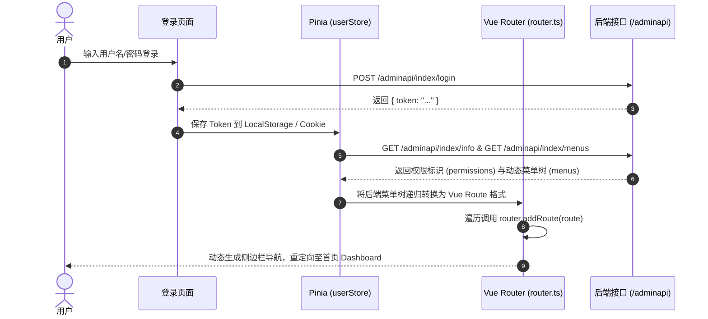

# HwAdmin 前端编码与工程规范

本规范确立了 HwAdmin 前端工程的架构标准、目录划分、API 网络封装、动态路由注册与权限控制机制。

---

## 一、工程目录与事实对齐

整个仓库中存在两个前端相关目录，所有 Agent 与前端开发者必须严格遵循以下边界：

1. **`admin-ui/`（当前活动的前端生产工程）**：
   - 这是 HwAdmin 管理后台的实际运行代码，基于 Vue 3 + Vite + TypeScript + Pinia 构建。
   - 所有的新功能开发、界面美化、API 对接、构建发布均必须且只能在 `admin-ui/` 下进行。
   - `admin-ui/mobile/` 是独立的 uni-app 通用移动端，采用 unibest 精简工程配置与 Wot UI V2（`@wot-ui/ui`），对接 `/api` 会员接口。依赖、锁文件、Vite 与 TypeScript 配置与 PC 后台隔离；具体接入、构建及业务扩展见 [移动端接入指南](移动端接入指南.md)。
   - 以下 Axios 与 Vue Router 规范适用于 PC 后台；移动端统一使用 `mobile/src/http/` 中基于 `uni.request` 的请求层，遵循同一 HwAdmin 响应契约，不携带管理员 Token。
2. **`Vite-vue/`（原始样板工程只读备份）**：
   - 这是初期初始化的基础模板备份。
   - **严格只读！** 仅作为设计比对、提取样式片段或参考原版组件用，**严禁向其中引入项目业务逻辑，严禁在此执行构建部署**。

---

## 二、网络请求与 API 封装规范

Windows 桌面壳位于 `admin-ui/src-tauri/`，采用 Tauri 2，复用 PC 后台页面和样式。桌面独立 `desktop` 构建模式使用 Hash 路由、`dist-desktop/` 产物及明确配置的服务端源地址；Web 保持同源。API、上传与后台公共资源地址通过 `src/utils/platform.ts` 适配，新增外部打开操作使用 `openExternalUrl`。禁止将桌面包的 `https://tauri.localhost` 当作 PHP 服务端。详见 [桌面端接入指南](桌面端接入指南.md)。

### 1. Axios 实例封装原则
前端必须在统一的网络模块（如 `src/utils/request.ts`）中创建 Axios 实例，并配置完善的请求拦截器与响应拦截器：

```typescript
import axios, { type AxiosRequestConfig, type AxiosResponse } from 'axios';
import { useUserStore } from '@/store/modules/user';
import { ElMessage } from 'element-plus'; // 或使用的对应 UI 库

const service = axios.create({
  baseURL: import.meta.env.VITE_APP_BASE_API || '/adminapi',
  timeout: 15000,
  headers: {
    'Content-Type': 'application/json;charset=utf-8'
  }
});

// 请求拦截器：自动注入 Bearer Token
service.interceptors.request.use(
  (config) => {
    const userStore = useUserStore();
    if (userStore.token) {
      config.headers.Authorization = `Bearer ${userStore.token}`;
    }
    return config;
  },
  (error) => Promise.reject(error)
);

// 响应拦截器：统一根据 HwAdmin 后端协议 (Result) 进行处理
service.interceptors.response.use(
  (response: AxiosResponse) => {
    const res = response.data;

    // 1: 业务成功
    if (res.code === 1) {
      return res.data;
    }

    // 401: 认证失效或未登录
    if (res.code === 401) {
      const userStore = useUserStore();
      userStore.resetToken();
      ElMessage.error(res.msg || '登录已过期，请重新登录');
      window.location.href = '/login';
      return Promise.reject(new Error(res.msg || 'Error'));
    }

    // 403: 权限不足
    if (res.code === 403) {
      ElMessage.warning(res.msg || '您暂无权限执行此操作');
      return Promise.reject(new Error(res.msg || 'Error'));
    }

    // 0 或其他业务错误码
    ElMessage.error(res.msg || '系统错误');
    return Promise.reject(new Error(res.msg || 'Error'));
  },
  (error) => {
    ElMessage.error(error.message || '网络连接超时');
    return Promise.reject(error);
  }
);

export default service;
```

---

## 三、动态路由与菜单渲染规范

HwAdmin 采用**后端权限驱动的前端动态路由**机制：



### 路由组件解析映射
后端返回的 `component` 字段遵循以下映射约定：
- `Layout`：主框架布局组件。
- `auth/admin/index`：对应前端物理文件 `src/views/auth/admin/index.vue`。
- `plugin:smoke/Index`：插件扩展页面，对应 `src/views/plugins/smoke/Index.vue`。

---

## 四、按钮级权限控制 (`v-auth`)

在管理后台中，除了路由级页面隔离外，页面内的“新增”、“修改”、“删除”、“导出”等细粒度按钮必须通过权限指令进行控制。

### 1. 指令注册 (`src/directives/auth.ts`)
```typescript
import type { Directive } from 'vue';
import { useUserStore } from '@/store/modules/user';

export const auth: Directive = {
  mounted(el, binding) {
    const { value } = binding;
    const userStore = useUserStore();
    const permissions = userStore.permissions; // 例如: ['*'] 或 ['auth/admin/index', 'auth/admin/add']

    if (value && Array.isArray(value) && value.length > 0) {
      const hasPermission = permissions.includes('*') || value.some(perm => permissions.includes(perm));
      if (!hasPermission) {
        // 无权限则从 DOM 树中移除节点
        el.parentNode && el.parentNode.removeChild(el);
      }
    } else {
      throw new Error(`需要指定权限节点值，例如 v-auth="['auth/admin/add']"`);
    }
  }
};
```

### 2. 模板使用规范
```html
<template>
  <div class="table-toolbar">
    <!-- 具备 auth/admin/add 权限时展示 -->
    <el-button v-auth="['auth/admin/add']" type="primary" @click="handleAdd">
      新增管理员
    </el-button>

    <!-- 具备 auth/admin/del 权限时展示 -->
    <el-button v-auth="['auth/admin/del']" type="danger" :disabled="!selectedRows.length" @click="handleBatchDelete">
      批量删除
    </el-button>
  </div>
</template>
```

---

## 五、AI Agent 界面与菜单设计原则

1. **分栏左侧菜单字数上限（硬性体验建议）**：
   - 本框架管理端默认采用分栏布局（`layout: 'column'`，`columnStyle: 'card'`）。
   - **1 级目录（左侧主栏）**：卡片宽度固定 `52px`（`--el-left-menu-width-min: 64px`，单行省略），**标题严格控制在 `3` 个汉字（或 `6` 个英文字符）以内**（如 `控制台`、`系统`、`权限`、`插件`、`内容`），禁止使用 4 字以上短语（如 `开发与运维中心` 会被截断或挤占视觉重心）。
   - **2 级菜单 / 3 级子菜单（次级边栏）**：次级栏宽约 `182px`（含图标与折叠箭头），**标题建议控制在 `6` 个汉字以内**（如 `主题与配置`、`内容与产品`、`菜单规则`），超过 6 个汉字易出现文字遮挡或换行折行。
2. **多插件安装与菜单归集原则**：
   - 插件在 `plugin.json` 中注册菜单时，若属常规业务模块且无强独立一级入口诉求，建议将次级菜单挂在现有归集目录或保持 1 级目录不超过 `3` 字；同时允许管理员在 **权限 - 菜单规则** 中自由拖拽/调整 `pid`（含一键“归集插件菜单”）。
   - 核心与插件更新流程（`MenuImporter` / `MenuSync`）默认**尊重并保留用户已自定义的菜单 `pid` 归属、标题、图标与排序**（仅补充新增节点与按钮权限），同时在后端做防循环引用与同父节点重名 `path` 自动去重，确保用户整理后的菜单长期稳定。
3. **按钮权限与视觉一致性**：
   - 每个列表页至少配齐 `index / add / edit / del` 子规则，前端操作按钮统一挂载 `v-auth="['<node>/add']"` 等指令，图标优先选用 RemixIcon 线性风格（如 `apps-2-line`、`file-text-line`、`settings-3-line`）。
4. **表格「操作」列统一按钮规范（强制标准）**：
   - 严禁在表格操作列裸用无边框 `link` / `text` 纯文字链接；所有 `<el-table-column label="操作" fixed="right" align="center">` 统一使用全局 `.hw-table-actions` 容器包裹紧凑 `size="small" plain` 柔和边框按钮（`<HwTable>` 默认 `#actions` 插槽已内置包裹）。
   - 统一语义配色：`success`（新增子项/启用/生成/分享/核销）、`primary`（编辑/执行/答复/复制/优化）、`info`（详情/日志/预览）、`warning`（真机模拟/警告操作）、`danger`（删除/回滚/撤回/驳回）。
   - 建议列宽保障桌面单行不换行：1 个按钮 `100px~130px`，2 个按钮 `168px~186px`，3 个按钮 `236px~260px`，4 个按钮 `286px~320px`；中小屏下由 `.hw-table-actions` 自动以 `gap: 6px` 居中折行对齐。
5. **图表 SVG 与图标防拉伸规范**：
   - 自绘 SVG 统计图禁止使用固定 `viewBox` 配合 `preserveAspectRatio="none"`，必须结合 `ResizeObserver` 按容器实时宽高等比计算坐标，确保圆点与刻度文字不发生椭圆拉伸；图标容器（`.metric-icon` / `.el-icon` / `.vab-icon`）统一保持 `flex-shrink: 0`。

---

## 六、`useCrudTable` 与 Element Plus 2.14+ 编码细节

1. **删除接口签名对齐**：对接 `useCrudTable` 时，`src/api/*.ts` 的删除方法及 `delApi` 签名必须为 `(ids: (number | string)[]) => Promise<any>`（不可窄化为 `number[]`），否则 `vue-tsc` 会报错：
   ```ts
   const { tableData, loading, pagination, handleDelete, handleBatchDelete } = useCrudTable<Item>({
     fetchApi: getItemList,
     delApi: (ids: (number | string)[]) => delItem(ids),
   })
   ```
2. **单选值绑定与时间戳判零**：`<el-radio>` / `<el-radio-button>` 一律使用 `:value`；格式化秒级时间戳时必须 `const n = Number(ts || 0); if (!n || n <= 0) return '-'`，避免 SQLite `"0"` 字符串被 `if (!ts)` 判真后渲染为 `1970-01-01`。
