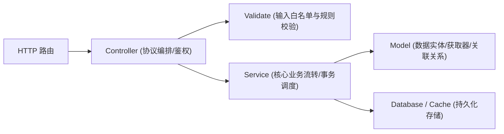

# HwAdmin 后端编码架构规范与铁律

本规范确立了 HwAdmin 后端（ThinkPHP 8.1 / PHP 8.2+）的代码编写标准与架构契约。所有 Agent 与开发者必须无条件遵照执行。

---

## 一、PHP 语言基线与代码风格

1. **严格类型声明铁律**：
   - 所有 PHP 文件第一行必须为 `<?php`，紧接着第二行必须声明严格类型模式：
     ```php
     <?php
     declare(strict_types=1);
     ```
2. **类型提示全覆盖**：
   - 所有方法的参数与返回值**必须明确声明类型提示**（可为空用 `?Type` 或联合类型 `TypeA|TypeB`，无返回值必须显式标注 `: void`）。
   - 禁止在关键业务逻辑中声明无约束的隐式变量。
3. **PSR-12 风格标准**：
   - 类名采用 `PascalCase`（如 `ArticleCategory`）。
   - 方法名与变量名采用 `camelCase`（如 `getUserInfo`, `$adminId`）。
   - 常量采用 `UPPER_SNAKE_CASE`（如 `CACHE_TTL`）。
   - 数据表名与数据表字段统一采用 `snake_case`（如 `user_id`, `create_time`）。

---

## 二、分层职责边界



### 1. 控制器层 (Controller)
- **职责**：只负责 HTTP 协议适配、参数接收、调用验证器校验、调度服务层或 Trait，并将结果委托给 `Result` 输出。
- **铁律**：
  - **严禁在 Controller 中编写复杂的 SQL 拼接与原生查询**。
  - **后台接口控制器**必须继承 `core\base\AdminController`；公开或免鉴权方法必须显式声明 `protected array $noNeedLogin = [...]` / `protected array $noNeedRight = [...]`（仅放行必要 Action，严禁在非公开管理接口中滥用 `['*']`）。
  - **前台开放接口控制器**必须继承 `core\base\ApiController`，通过 `$noNeedLogin` 精准豁免无需登录的接口。
  - **禁止定义 `public` 辅助方法**：控制器中除路由 Action 外，所有内部辅助方法必须声明为 `protected` 或 `private`，防止被框架自动路由暴露为公网接口。
  - **点号路由映射**：子目录控制器使用 `.` 映射 URL 与权限节点（如 `app\adminapi\controller\auth\AdminLog::index` → URL `/adminapi/auth.admin_log/index`，权限节点 `auth/admin_log/index`）。
  - **后台入口安全**：`admin_entry` 由站点配置与网关统一管控，严禁在控制器或前端代码中硬编码或私改 `admin_entry`。
  - 公开方法（Action）应尽可能简练，单方法原则上不超过 50 行代码。

### 2. 验证器层 (Validate)
- **职责**：参数边界防护第一道闸门。定义参数存在性、类型、长度、正则校验。
- **铁律**：
  - 核心接口的 POST/PUT 请求必须经由验证器校验。
  - 验证失败时统一抛出包含友好中文提示的 `core\exception\ApiException`。

### 3. 服务层 (Service)
- **职责**：承载核心复杂业务逻辑、多模型协作编排、外部第三方服务调用、多表跨库数据库事务控制。
- **铁律**：
  - Service 类必须是无状态的单例或依赖注入对象。
  - 遇到业务阻断逻辑，统一抛出带有业务错误码的 `ApiException`，严禁在 Service 中直接调用 `exit`、`die` 或直接返回 HTTP Response。

### 4. 模型层 (Model)
- **职责**：定义单表的数据实体映射、属性类型转换（`type`）、字段隐藏（`hidden`）、关联关系（`hasOne` / `hasMany` / `belongsTo`）、获取器（`get...Attr`）与修改器（`set...Attr`）。
- **铁律**：
  - 模型只处理与自身表强相关的数据格式化或原子操作，不要在单个 Model 中塞入跨多个模块的大一统业务。
  - 软删除统一使用 ThinkORM 官方的 `SoftDelete` Trait，时间字段字段名固定为 `delete_time`。

---

## 三、通用 CRUD 引擎规范 (`CrudTrait`)

HwAdmin 提供了高灵活性、开箱即用的 CRUD 能力。凡是具备标准列表、详情、新增、编辑、删除的后台业务控制器，均应直接引入 `core\crud\CrudTrait`。

### 1. 规范用法示例

```php
<?php
declare(strict_types=1);

namespace app\adminapi\controller\content;

use app\common\model\Article as ArticleModel;
use core\base\AdminController;
use core\crud\CrudTrait;
use think\db\BaseQuery;

class Article extends AdminController
{
    use CrudTrait;

    // 指定关键词搜索作用的字段（模糊匹配）
    protected array $searchFields = ['title', 'summary'];

    // 指定客户端写入/修改时允许的白名单字段（防批量赋值攻击）
    protected array $allowFields = ['title', 'summary', 'content', 'category_id', 'status'];

    // 查询列表和详情时从结果中安全隐藏的字段
    protected array $hiddenFields = [];

    // 默认排序字段
    protected string $defaultSort = 'id';

    protected function initialize(): void
    {
        parent::initialize();
        $this->model = new ArticleModel();
    }

    /**
     * 扩展点 1：自定义列表查询条件（如只能查看当前管理员创建的或特定租户的数据）
     */
    protected function buildIndexQuery(): BaseQuery
    {
        $query = $this->model->where('status', '>=', 0);
        if (!$this->auth->isSuperAdmin()) {
            $query->where('admin_id', $this->auth->id());
        }
        return $query;
    }

    /**
     * 扩展点 2：写入前数据预处理（新增或编辑保存前）
     */
    protected function beforeWrite(array $data, ?\think\Model $row = null): array
    {
        if ($row === null) {
            // 新增操作
            $data['admin_id'] = $this->auth->id();
        }
        return $data;
    }

    /**
     * 扩展点 3：写入后触发事务内副作用（如同步维护关联表、写日志）
     */
    protected function afterWrite(\think\Model $row, array $data, bool $isNew): void
    {
        // 同步标签关联等
    }
}
```

### 2. 覆盖默认方法与重用实现
如果在控制器中需要覆盖 Trait 中的方法（如删除前做额外业务检查），必须使用 protected 别名引入，防止别名变成可从 URL 访问的公网 Action：
```php
class Article extends AdminController
{
    use CrudTrait {
        del as protected crudDel;
    }

    public function del(): void
    {
        // 1. 自定义前置检查
        $id = $this->request->param('id');
        // ...
        
        // 2. 复用底层删除实现
        $this->crudDel();
    }
}
```

---

## 四、异常与错误处理铁律

1. **严禁裸抛未捕获异常**：
   - 业务逻辑中断必须抛出 `core\exception\ApiException`：
     ```php
     throw new ApiException('余额不足，无法完成划扣', Result::FAIL);
     ```
2. **统一全局接管**：
   - 系统已在 `app\ExceptionHandle` 中全局接管所有异常。任何未捕获的系统级致命错误在生产环境下（`APP_DEBUG=false`）均会自动脱敏，只返回通用的“系统繁忙，请稍后再试”，并在后台写入严格的跟踪日志，严禁将数据库报错或堆栈信息泄露给前端。
3. **数据一致性与事务**：
   - 跨两个及以上数据表的操作必须使用事务包裹：
     ```php
     $this->model->transaction(function () use ($data) {
         // 原子操作 1
         // 原子操作 2
     });
     ```
