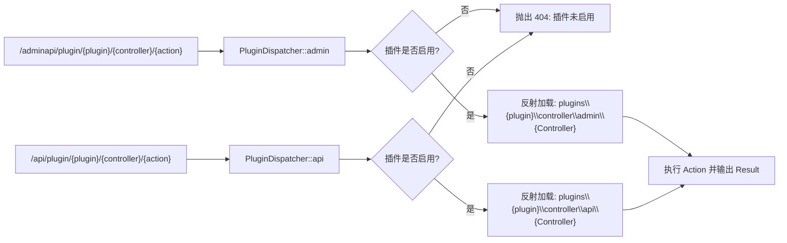
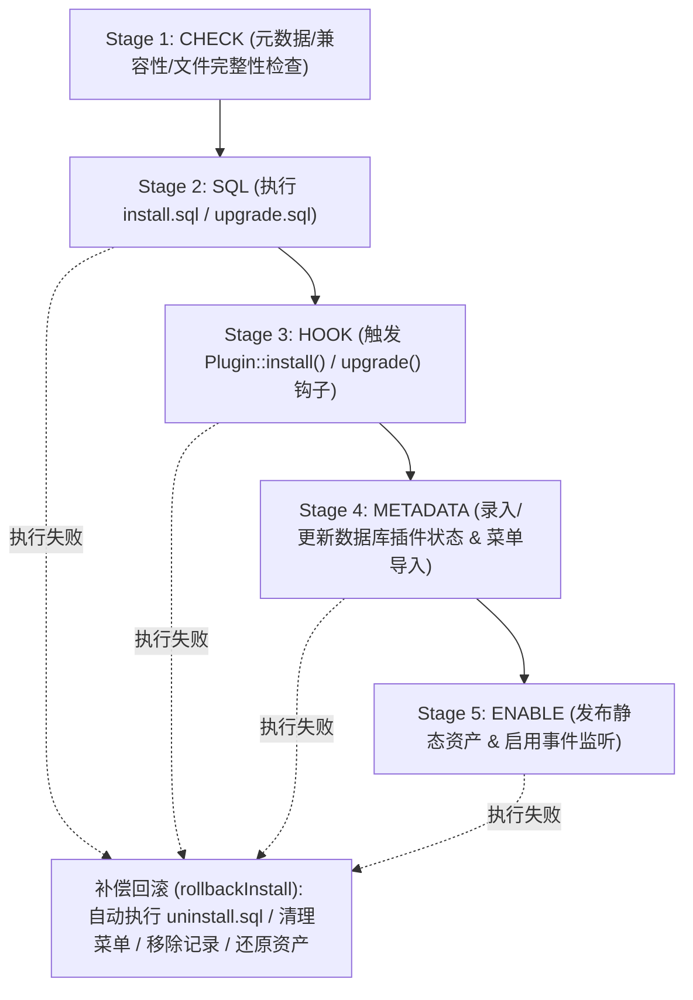

# HwAdmin 零侵入插件系统开发规范与标准

HwAdmin 采用了革命性的**零侵入、物理隔离、可热插拔**的插件架构，彻底避免了传统插件安装时暴力拷贝代码、污染核心目录、卸载残留难以清理的弊病。

所有插件均存放在独立的 `plugins/{name}/` 目录中，在不修改框架核心一行代码的前提下实现路由扩展、数据库迁移、事件监听与静态资源发布。

---

## 一、插件标准目录结构

每个插件为一个独立的子文件夹，文件夹名称即为插件的唯一系统标识（`name`，仅允许小写字母、数字及下划线，必须以字母开头）：

```
plugins/demo/
├── plugin.json              # 插件核心清单元数据文件 (必须)
├── Plugin.php               # 插件主类，继承 core\plugin\Plugin (必须)
├── config.php               # 插件私有默认配置 (可选)
├── controller/              # 插件控制器目录
│   ├── admin/               # 后台控制器，继承 core\base\AdminController
│   │   └── Index.php
│   └── api/                 # 前台接口控制器，继承 core\base\ApiController
│       └── Index.php
├── database/                # 插件独立数据迁移与初始化
│   └── migrations/          # Phinx 迁移文件 (安装时执行，卸载时回滚)
│       └── 20261101000001_create_demo_table.php
├── listener/                # 插件事件监听器类
│   └── LoginLog.php
└── web/                     # 插件静态资源或前端组件包 (可选)
    ├── css/
    ├── js/
    └── index.html
```

---

## 二、`plugin.json` 架构与 Schema 定义

每个插件根目录下必须包含一个严格符合 JSON 语法的 `plugin.json` 清单文件：

```json
{
  "name": "demo",
  "title": "示例扩展插件",
  "version": "1.0.0",
  "description": "用于演示 HwAdmin 零侵入插件机制的标准插件模板",
  "author": "HwAdmin Team",
  "require": {
    "hwadmin": ">=0.1.0",
    "php": ">=8.2",
    "plugins": {
      "storage_oss": ">=1.0.0"
    }
  },
  "menus": [
    {
      "type": "dir",
      "title": "演示模块",
      "name": "plugin/demo/group",
      "icon": "apps-line",
      "path": "demo",
      "children": [
        {
          "type": "menu",
          "title": "数据管理",
          "name": "plugin/demo/index",
          "icon": "table-line",
          "path": "index",
          "component": "plugin:demo/Index"
        }
      ]
    }
  ],
  "config": [
    {
      "name": "app_id",
      "title": "应用 AppID",
      "type": "string",
      "value": "hw_demo_123456",
      "tip": "从第三方开放平台获取的凭证"
    },
    {
      "name": "is_open",
      "title": "是否开启同步",
      "type": "switch",
      "value": 1
    }
  ]
}
```

### 字段说明：
- **`name`**：插件系统标识（小写，且必须与目录名完全一致）。
- **`version`**：符合语义化版本标准（如 `1.0.0`）。
- **`require`**：依赖声明。安装前系统会自动进行严格的兼容性校验，不满足时阻断安装。
  - `hwadmin`：要求的最低框架版本。
  - `php`：要求的最低 PHP 版本。
  - `plugins`：依赖的其他插件标识与版本范围。
- **`menus`**：插件附带的菜单树。安装/启用时由 `MenuImporter` 自动导入到 `hw_auth_rule` 表中，并在卸载时全量自动清除。
- **`config`**：声明插件可配置项，将在后台“插件配置”界面自动渲染为表单供管理员配置。
- **菜单字数红线**：受左侧分栏布局宽度限制，`menus` 中 **1 级目录标题严格 `≤ 3` 个汉字**（如 `演示`、`内容`、`商城`），**2 级菜单标题严格 `≤ 6` 个汉字**（如 `数据管理`、`订单列表`），防止截断或换行遮挡。
- **双库迁移首选 `database/migrations/`（Phinx）**：为保证 MySQL 8.0+ / PostgreSQL 16+ / SQLite 原生兼容与可回滚能力，插件建表与字段变更**首选在 `database/migrations/` 中编写 Phinx 迁移文件**，避免手写数据库方言 SQL。

---

## 三、插件生命周期与主类规范 (`Plugin.php`)

插件主类必须位于 `plugins\{name}\Plugin.php`，命名空间为 `plugins\{name}`，并必须继承 `core\plugin\Plugin` 基类：

```php
<?php
declare(strict_types=1);

namespace plugins\demo;

use core\plugin\Plugin as BasePlugin;

class Plugin extends BasePlugin
{
    /**
     * 声明插件要监听的系统事件与钩子
     */
    public function events(): array
    {
        return [
            'AdminLoginAfter' => [listener\LoginLog::class],
        ];
    }

    /**
     * 每次 HTTP 请求初始化阶段执行（仅当插件处于“启用”状态时被调用）
     * 用于注册动态服务、单例绑定等
     */
    public function boot(): void
    {
    }

    /**
     * 插件安装时触发（在执行数据库迁移与菜单导入之后）
     */
    public function install(): void
    {
    }

    /**
     * 插件卸载时触发（在删除菜单与回滚数据之前）
     */
    public function uninstall(): void
    {
    }

    /**
     * 插件启用时触发
     */
    public function enable(): void
    {
    }

    /**
     * 插件禁用时触发
     */
    public function disable(): void
    {
    }

    /**
     * 插件升级时触发（$from 为旧版本号）
     */
    public function upgrade(string $from): void
    {
    }
}
```

---

## 四、自动路由派发机制 (`PluginDispatcher`)

无需手动在路由文件中注册，框架底层已统一接管插件的路由调度：



### 路由映射规则：
1. **后台路由**：
   `GET /adminapi/plugin/demo/index/index`  
   自动映射调用：`plugins\demo\controller\admin\Index::index()`
2. **多级子目录控制器**：
   `POST /adminapi/plugin/demo/order.report/export`  
   自动映射调用：`plugins\demo\controller\admin\order\Report::export()`
3. **前台路由**：
   `GET /api/plugin/demo/index/hello`  
   自动映射调用：`plugins\demo\controller\api\Index::hello()`

---

## 五、静态资源发布解耦 (`AssetPublisher`)

插件目录若包含前端静态资源（位于 `plugins/{name}/web/`），系统在插件安装/启用时，通过 `core\plugin\AssetPublisher` 自动将其发布到 Web 可直访的根目录：
- 发布目标路径：`server/public/plugins/{name}/`
- **开发环境下**：优先尝试创建跨目录软链接（Symlink），修改 `web/` 内文件立即生效，无需反复构建拷贝。
- **生产环境下**：通过文件递归同步复制，确保跨卷/容器环境稳定。
- **卸载/禁用时**：自动安全移除 `public/plugins/{name}/`，保持站点根目录彻底干净。


---

## 六、分阶段安装/升级生命周期与回滚规范 (S05)

为避免插件安装、升级过程中发生断电或 SQL 语法错误导致脏数据残留，插件安装严格按照以下 5 个明确阶段执行：



### 补偿回滚规范：
1. **DDL 回滚机制**：若 `install.sql` 执行中途抛出异常，系统自动捕获并定位执行同目录下的 `uninstall.sql`（若存在），执行清理操作并清除非法表结构；
2. **菜单清理**：通过 `MenuImporter::remove($name)` 确保未完成安装的残留权限规则节点全部清理；
3. **状态保证**：回滚完成后插件表记录与发布静态目录恢复至未安装初始纯净状态，返回清晰的失败阶段日志与错误原因，支持排错后重复安装重试。

---

## 七、前端组件集成与安全边界 (E02)

1. **前端集成策略**：
   - **构建期官方深度集成**：如系统核心富文本插件 (`editor`)、短信插件 (`sms`)，在 `admin-ui/src/views/plugin/` 下拥有标准 Vue 3 源码，享受 Vite 严格的 TypeScript 类型推导与生产摇树打包（Tree-shaking）；
   - **免编译微视图模式（最推荐业务与三方插件使用：`public/plugins/{name}/admin.html`）**：
     - 插件可将自包含的管理端页面置于 `plugins/{name}/web/admin.html`（发布后位于 `server/public/plugins/{name}/admin.html`），无需重新编译 `admin-ui/`，**与框架 OTA 升级完全隔离**；
     - **零外链离线铁律**：微视图内严禁加载外部 CDN 脚本/字体/样式（`cdn.jsdelivr.net`、`unpkg.com` 等），所有依赖须内联或随插件 `web/` 目录本地分发，保障纯内网冷部署可用；
     - **PostMessage Token 桥接**：微视图通过 `Iframe` 嵌入管理后台时，通过标准 `window.addEventListener('message', ...)` 接收宿主下发的认证 Token 与主题/语言上下文（严禁在 URL Query 中明文传递 Token），并使用该 Token 请求 `/adminapi/plugin/{name}/*`。
   - **运行时物理隔离分发**：其他静态资源发布在 `public/plugins/{name}/` 下，通过 `/adminapi/plugin/{name}/*` 与 `/api/plugin/{name}/*` 暴露受控 API。
2. **安全边界与非沙箱声明**：
   - **非操作系统级沙箱**：PHP 插件目录的物理隔离仅是软件工程层面的模块化组织，**不代表内核级安全沙箱**；
   - **基类与控制器约束**：插件后台控制器必须严格继承 `core\base\AdminController`，前台接口必须继承 `core\base\ApiController`，未继承基类的插件控制器在路由分发时将被 404 强制阻断；
   - **权限节点越权阻断**：插件只允许注册以 `plugin/{name}/` 为前缀的菜单与权限节点，严禁篡改或越权注册核心系统节点（如 `auth/*`、`system/*`）；
   - **敏感配置保护**：插件配置如包含第三方 AppSecret、私钥等机密数据，必须保存在 `config.php` 或经由后台受控更新，严禁在前台 API 中明文序列化输出。


---

## 八、插件版本迭代与商城发布全局规则 (Global Update Policy)

所有上架或内置插件在每次代码优化、样式修复或功能增强后，必须遵循与 HwAdmin 主框架完全一致的语义化版本迭代规范并同步发布至应用商城：

1. **版本号规则（`x.y.z`，与主框架 `Vx.y.z` 看齐）**：
   - **`x`（大版本）**：仅限项目负责人显式拍板变更，禁止脚本或常规迭代自动递增；
   - **`y`（次版本 / minor）**：新增用户可见功能、模板、重要配置项、接口契约变更或数据库结构调整时 `y + 1`、`z` 归 `0`；
   - **`z`（修订号 / patch）**：缺陷修复、菜单/样式精修、自适应优化、文档与单点微调时 `z + 1`（拿不准时按 `patch` 处理）。
   - **单调递增基准**：以本地 `plugin.json` 与应用商城当前线上 `latest_version` 的较高者作为迭代基线。
2. **标准自动发布流（`scripts/publish_plugin.py` 仅限官方市场维护者使用）**：
   - 官方市场维护者运行 `python scripts/publish_plugin.py --plugin <name> --bump <patch|minor> --changelog "..."`（可选 `--deploy-baota` / `--upload-http`）自动完成：版本号递增 → `plugin.json` 与市场母仓源码同步 → `{name}-v{x.y.z}.zip` 打包校验 → 上传发布至应用商城 → 客户端通过「检查更新 / 在线更新」热升级闭环验证。
   - 普通业务/插件开发者只需在本地按上述规则递增 `plugin.json` 版本号并完成本地安装/升级测试即可。
