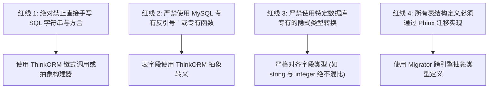

# HwAdmin 数据库设计与双栈兼容规范

本规范确立了 HwAdmin 数据存储底座的设计准则、MySQL / PostgreSQL 原生双栈兼容铁律以及基于 Phinx 的数据库迁移管理标准。

---

## 一、双栈兼容核心铁律

HwAdmin 承诺开箱即用支持两大主力关系型数据库引擎：
1. **MySQL 8.0+ / 8.4 LTS**（同时兼容 MariaDB 10.6+）。
2. **PostgreSQL 16+**（同时兼容国产化信创数据库，如人大金仓 Kingbase、华为 openGauss 等）。

为了达成 100% 原生双栈兼容，所有开发者与 Agent 必须无条件遵守以下开发红线：



---

## 二、表结构与字段命名规范

1. **命名规范**：
   - 表名与字段名统一采用**全小写字母加下划线**（`snake_case`）。
   - 表名前缀由环境配置 `DB_PREFIX` 动态决定（默认为 `hw_`），在代码和迁移中声明时不包含前缀。
   - 主键字段统一命名为 `id`，类型为自动递增正整数。
2. **时间戳字段铁律**：
   - **严禁使用 `datetime` 或 `timestamp` 物理列类型！**
   - 核心业务表的时间字段**统一使用 `BIGINT`（64位长整型）存储 Unix 时间戳**（秒级）。
   - 命名标准：
     - `create_time`：创建时间戳。
     - `update_time`：最后修改时间戳。
     - `delete_time`：软删除时间戳（默认 `null` 或 `0`）。
   - **选型理由**：
     - 彻底消除跨时区部署时 MySQL 与 PostgreSQL 时区配置不一致导致的计算偏差。
     - 跨数据库类型转换零成本，整数数值比对与索引扫描性能极致优异。
3. **布尔与状态字段**：
   - 统一采用小整数 `integer`（limit: 1），如 `status`（1=正常，0=禁用）。
4. **长文本与 JSON**：
   - 存储配置、扩展属性等非定长数据，统一使用 `text` 字段，以 JSON 格式存储并在模型层序列化。

---

## 三、Phinx 数据库迁移规范 (`database/migrations/`)

所有核心表与插件表结构的创建、修改必须编写 Phinx 迁移文件，禁止在生产或开发环境手动执行 DDL 语句。

### 1. 迁移文件命名规范
迁移文件存放于 `server/database/migrations/`，文件命名格式必须为：
`YYYYMMDDHHMMSS_action_table_name.php`  
例如：
- `20261026000001_create_core_tables.php`
- `20261101000002_add_avatar_to_user_table.php`

### 2. 标准迁移编写示例

```php
<?php
declare(strict_types=1);

use think\migration\Migrator;

class CreateArticleTable extends Migrator
{
    public function change(): void
    {
        $table = $this->table('article', ['comment' => '文章数据表']);
        $table
            ->addColumn('category_id', 'integer', ['default' => 0, 'comment' => '分类ID'])
            ->addColumn('admin_id', 'integer', ['default' => 0, 'comment' => '发布管理员ID'])
            ->addColumn('title', 'string', ['limit' => 150, 'default' => '', 'comment' => '文章标题'])
            ->addColumn('keywords', 'string', ['limit' => 200, 'default' => '', 'comment' => '关键词'])
            ->addColumn('summary', 'string', ['limit' => 500, 'default' => '', 'comment' => '摘要描述'])
            ->addColumn('content', 'text', ['null' => true, 'comment' => '文章正文内容'])
            ->addColumn('views', 'integer', ['default' => 0, 'comment' => '浏览阅读量'])
            ->addColumn('status', 'integer', ['limit' => 1, 'default' => 1, 'comment' => '状态: 1=正常, 0=草稿'])
            ->addColumn('create_time', 'biginteger', ['default' => 0, 'comment' => '创建时间戳'])
            ->addColumn('update_time', 'biginteger', ['default' => 0, 'comment' => '更新时间戳'])
            ->addColumn('delete_time', 'biginteger', ['default' => 0, 'comment' => '软删除时间戳'])
            ->addIndex(['category_id'])
            ->addIndex(['status'])
            ->create();
    }
}
```

### 3. 迁移不可变性原则
- **已合并进主干并发布的迁移文件严禁直接修改！**
- 若需要追加字段、删除字段或变更索引，必须创建一个新的迁移文件执行变更（如使用 `$table->addColumn(...)` 或 `$table->dropColumn(...)`），以确保团队其他协作 Agent 与用户环境可增量回溯。
