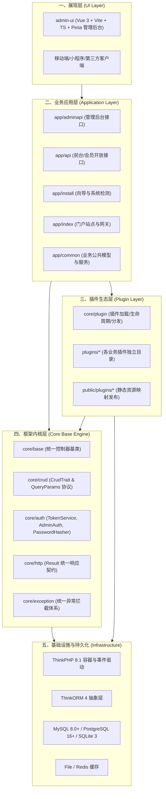
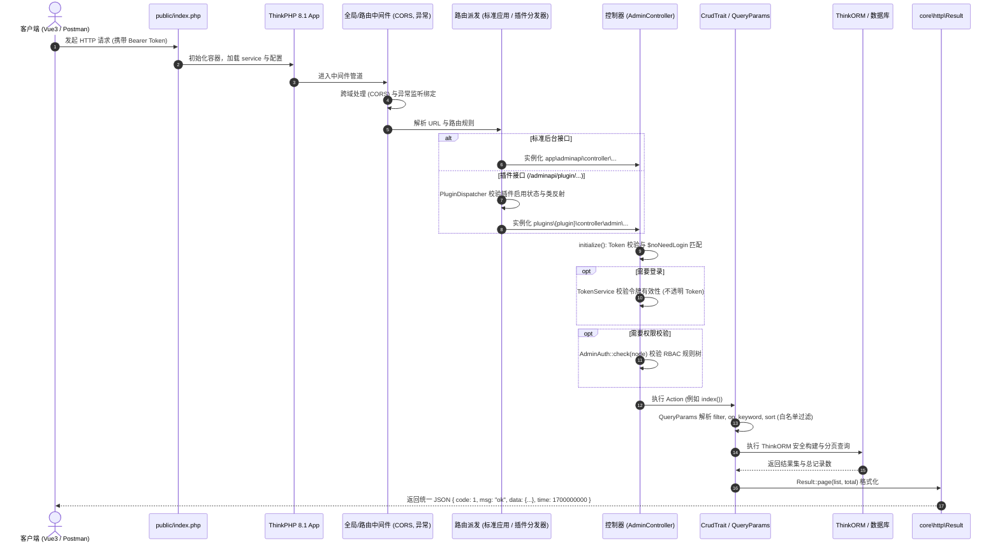

# HwAdmin 系统分层架构设计与全景说明

本文档详细描述 HwAdmin 的系统分层架构、目录职责、多应用边界划分与 HTTP 请求生命周期。

---

## 一、系统整体分层架构

HwAdmin 采用“内核驱动、业务解耦、插件隔离、前后端分离”的四层架构设计，各层职责边界分明，严禁反向污染。

---

## 二、目录职责与边界契约

### 1. `server/core/` (框架内核层 - 严禁业务污染)
框架的核心基座，定义了底层标准，保证框架各应用和插件具备统一的行为特征：
- `core/base/`：
  - `BaseController`：提供基础的请求获取、跨域支持、快捷响应。
  - `AdminController`：后台管理控制器基类，内建 `$noNeedLogin`、`$noNeedRight` 鉴权与节点自动推导。
  - `ApiController`：前台接口控制器基类，内建会员鉴权机制。
- `core/crud/`：
  - `CrudTrait`：标准 CRUD（`index/read/add/edit/del`）开箱即用，提供完整的写入前后钩子。
  - `QueryParams`：列表筛选协议解析器，安全白名单校验，原生支持结构化复合条件高级筛选与排序搜索。
- `core/auth/`：
  - `TokenService`：SHA-256 不透明令牌生成、校验与服务端主动吊销。
  - `PasswordHasher`：采用现代高强度 bcrypt 密码哈希算法，并提供旧版散列渐进式无感升级能力。
  - `AdminAuth` / `UserAuth`：RBAC 权限检查器与节点鉴权。
- `core/http/`：
  - `Result`：统一 API 响应格式制造工厂。
- `core/exception/`：
  - `ApiException`：统一业务异常，负责安全脱敏并输出标准 JSON 格式。
- `core/plugin/`：
  - 插件清单解析、生命周期调度器、路由动态分发与静态资源发布工具。

### 2. `server/app/` (业务应用层)
ThinkPHP 多应用架构，按业务受众物理隔离：
- `app/adminapi/`：管理后台 RESTful 接口，所有控制器必须继承 `core\base\AdminController`。
- `app/api/`：前台与会员端接口，所有控制器必须继承 `core\base\ApiController`。
- `app/install/`：系统初始化向导，负责环境检测、数据库导入与管理员账号设置。
- `app/index/`：前台门户站点与默认健康检查入口。
- `app/common/`：多应用间共享的 Eloquent/ThinkORM 模型实体、验证器及核心领域服务。

### 3. `server/plugins/` (零侵入插件层)
独立业务功能扩展目录。每个插件为一个子目录 `plugins/{name}/`，包含完整的独立清单 `plugin.json`、主类 `Plugin.php`、私有控制器、迁移与静态资源。完全不修改 `app/` 和 `core/` 的代码。

### 4. 前端目录与安全边界
- `admin-ui/`：**唯一生产级管理端前端源码工程**（Vue 3 + Vite + TypeScript + Pinia）。
- **前端安全边界对照**：
  - 🟢 **推荐扩展**：独立插件免编译微视图 `server/public/plugins/{name}/admin.html`，或业务页面 `src/views/{biz}/` + `src/api/{biz}.ts`；
  - 🔴 **内核禁改**：`src/layout/`、`src/router/`、`src/store/`、`src/directives/`、`src/components/FrameworkUpdateDialog.vue`、`src/views/system/plugin/`；
  - 🟡 **构建与指纹保护**：修改 `admin-ui/` 后必须运行 `pnpm check && pnpm build:sync`，自动写入 `server/public/admin/hwadmin-official-ui.json`（`official: false`）二开保护指纹，OTA 升级将自动跳过 `public/admin/`；**严禁删除或手动伪造 `hwadmin-official-ui.json`**。

---

## 三、HTTP 请求全生命周期

从客户端发起请求到最终接收响应，HwAdmin 的完整执行链条如下：

---

## 四、多应用与路由划分规范

HwAdmin 采用清晰的 URI 映射体系：

| 应用名称 | 基础路由前缀 | 控制器基类 | 核心受众与安全策略 |
| :--- | :--- | :--- | :--- |
| **管理后台 API** | `/adminapi/*` | `core\base\AdminController` | 管理员操作，默认全接口需要鉴权与 RBAC 权限拦截 |
| **前台/会员 API** | `/api/*` | `core\base\ApiController` | 移动端、会员中心、第三方客户端，默认公开或会员鉴权 |
| **安装向导** | `/install` | `think\App` 原生控制 | 仅在无 `install.lock` 时开放，安装完成后锁定 |
| **插件后台路由** | `/adminapi/plugin/{name}/*` | `AdminController` | 由 `PluginDispatcher` 分发，同等受管理员 RBAC 约束 |
| **插件前台路由** | `/api/plugin/{name}/*` | `ApiController` | 由 `PluginDispatcher` 分发，同等受前台会员鉴权约束 |
